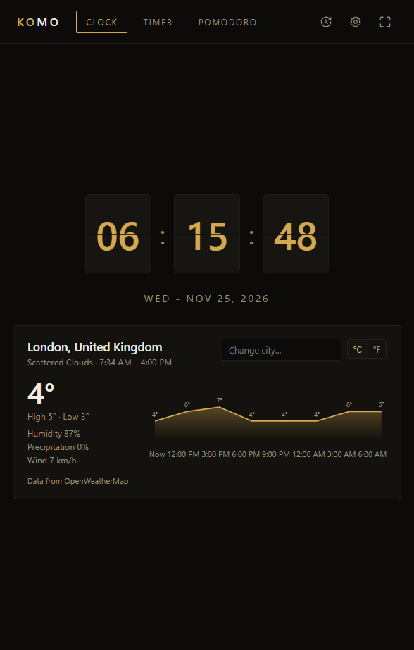
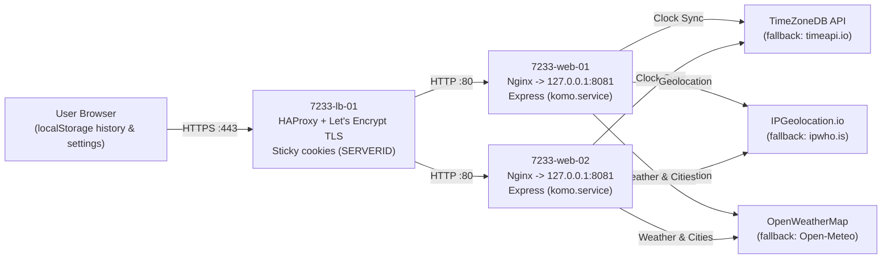

# Komo

Komo is a distraction-free **Clock, Timer, Pomodoro, and Live Weather** workspace built with Node.js, Express, and vanilla HTML/CSS/JavaScript.

**Live app:** [https://gagaba.tech](https://gagaba.tech) ([https://www.gagaba.tech](https://www.gagaba.tech))

---

## Product preview



### Interface sketch

```text
+-------------------------------------------------------------------------+
| KOMO   [ CLOCK ]   TIMER   POMODORO               [History] [Gear] [FS] |
+-------------------------------------------------------------------------+
|                                                                         |
|                 +--------+   +--------+   +--------+                    |
|                 |   06   | : |   15   | : |   48   |                    |
|                 +--------+   +--------+   +--------+                    |
|                          WED - NOV 25, 2026                             |
|                                                                         |
|   +-----------------------------------------------------------------+   |
|   | London, United Kingdom        [ Change city... ]   [ C | F ]    |   |
|   | Scattered Clouds · 7:34 AM - 4:00 PM                            |   |
|   |   4°                          /\___                             |   |
|   |   High 5° · Low 3°           /     \___                         |   |
|   |   Humidity 87%              Now  3PM  9PM  3AM  6AM             |   |
|   |   Data from OpenWeatherMap                                      |   |
|   +-----------------------------------------------------------------+   |
+-------------------------------------------------------------------------+
```

Switching to **Timer** or **Pomodoro** replaces the weather card with `Start` / `Pause` / `Resume` / `Stop` controls and opens task/duration modals. Completed Pomodoro sessions save to the **History** drawer (`localStorage`) with live search, `All` / `Done` / `Not done` filtering, sorting (`Newest`, `Oldest`, `Longest`), and delete.

---

## System architecture



---

## External APIs & credits

| API | Purpose in Komo | Fallback | Credit |
| :--- | :--- | :--- | :--- |
| **TimeZoneDB API** | Syncs the live flip-card clock to the selected location's timezone (`GET /api/time`) | `timeapi.io` | [timezonedb.com/api](https://timezonedb.com/api) |
| **IPGeolocation.io** | Detects the visitor's initial city and coordinates (`GET /api/locate`) | `ipwho.is` | [ipgeolocation.io](https://ipgeolocation.io/) |
| **OpenWeatherMap API** | Current conditions, 3-hour forecast curve, and city search (`GET /api/weather`, `GET /api/cities`) | `Open-Meteo` | [openweathermap.org/api](https://openweathermap.org/api) |

Error handling:
- Every upstream request uses a 6-second timeout (`AbortSignal.timeout(6000)`) inside `fetchJson()`.
- If any primary API key is missing, times out, or returns an invalid payload, the backend falls back automatically to the secondary provider.
- Invalid coordinates (`lat`/`lon`) return `400 Bad Request`, and upstream failures return clean JSON errors without crashing the server.

---

## Project structure

```text
KOMO/
├── .gitignore
├── README.md
├── assets/
│   └── komo-preview.png         # Live screenshot from gagaba.tech
├── backend/
│   ├── package.json             # Express and dotenv
│   ├── package-lock.json
│   └── server.js                # Static serving, /api/health, /api/time, /api/locate, /api/cities, /api/weather
└── frontend/
    ├── html/index.html          # App shell, weather panel, modals, and drawers
    ├── scripts/app.js           # Clock, timer, pomodoro, history, and SVG weather chart
    └── styles/style.css         # Dark-gold responsive theme
```

---

## Local setup

1. **Install dependencies:**
   ```bash
   cd backend
   npm install
   ```

2. **Create `backend/.env`** (excluded from Git via `.gitignore`):
   ```env
   PORT=8081
   HOST=127.0.0.1
   TIMEZONEDB_API_KEY=your_timezonedb_key
   OPENWEATHER_API_KEY=your_openweathermap_key
   IPGEO_API_KEY=your_ipgeolocation_key
   ```

3. **Start the server:**
   ```bash
   npm start
   ```
   Open `http://127.0.0.1:8081`.

---

## Production deployment

Komo runs across three Ubuntu 20.04 servers behind `gagaba.tech` (DNS `A` records `@` and `www` -> `35.177.191.45`):

| Server | IP | Role |
| :--- | :--- | :--- |
| **`7233-lb-01`** | `35.177.191.45` | HAProxy TLS termination (`:443`), HTTP-to-HTTPS `301` redirect (`:80`), round-robin balancing |
| **`7233-web-01`** | `35.178.147.32` | Nginx reverse proxy (`:80` -> `127.0.0.1:8081`) + Node.js 20 (`komo.service`) |
| **`7233-web-02`** | `35.179.168.186` | Nginx reverse proxy (`:80` -> `127.0.0.1:8081`) + Node.js 20 (`komo.service`) |

### 1. Deploy application nodes (`7233-web-01` and `7233-web-02`)

1. Install Node.js 20, Git, and Nginx, clone `KOMO`, install production dependencies, and place `backend/.env`:
   ```bash
   git clone https://github.com/gabrielagaba1/KOMO.git ~/KOMO
   cd ~/KOMO/backend && npm install --omit=dev
   ```

2. Run the backend as `/etc/systemd/system/komo.service`:
   ```ini
   [Unit]
   Description=Komo Node.js Backend
   After=network.target

   [Service]
   Type=simple
   User=ubuntu
   WorkingDirectory=/home/ubuntu/KOMO/backend
   ExecStart=/usr/bin/node /home/ubuntu/KOMO/backend/server.js
   Restart=on-failure
   Environment=NODE_ENV=production

   [Install]
   WantedBy=multi-user.target
   ```

3. Configure Nginx (`/etc/nginx/sites-available/komo`) for `gagaba.tech` and `www.gagaba.tech` -> `http://127.0.0.1:8081`, enable it, and reload Nginx.

### 2. Configure load balancer (`7233-lb-01`)

1. Issue a Let's Encrypt certificate for `gagaba.tech` and `www.gagaba.tech` and combine `fullchain.pem` + `privkey.pem` into `/etc/haproxy/certs/gagaba.tech.pem`.
2. Configure `/etc/haproxy/haproxy.cfg`:
   ```haproxy
   frontend http-in
       bind *:80
       bind *:443 ssl crt /etc/haproxy/certs/gagaba.tech.pem
       http-request set-header X-Forwarded-Proto https if { ssl_fc }
       redirect scheme https code 301 if !{ ssl_fc }
       default_backend web-backend

   backend web-backend
       mode http
       balance roundrobin
       cookie SERVERID insert indirect nocache
       option httpchk GET /api/health HTTP/1.1\r\nHost:\ gagaba.tech
       http-check expect status 200
       server 7233-web-01 35.178.147.32:80 check cookie web01
       server 7233-web-02 35.179.168.186:80 check cookie web02
   ```
3. Validate and start HAProxy (`sudo haproxy -c -f /etc/haproxy/haproxy.cfg && sudo systemctl start haproxy`).

### 3. Verify load balancing & HTTPS

```bash
curl -sI https://gagaba.tech/api/health
curl -sI https://www.gagaba.tech/api/health
```

Observed results:
- Request 1: `HTTP/1.1 200 OK` with `set-cookie: SERVERID=web01; path=/`
- Request 2: `HTTP/1.1 200 OK` with `set-cookie: SERVERID=web02; path=/`
- Live browser check on `https://gagaba.tech/` confirmed TLS, live Clock/Weather/City APIs (`200 OK`), Settings, Timer, and Pomodoro with zero console or network errors.
